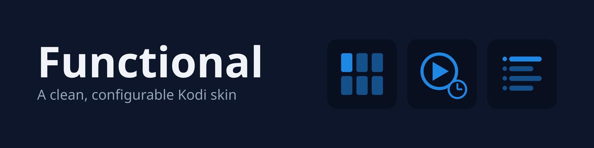
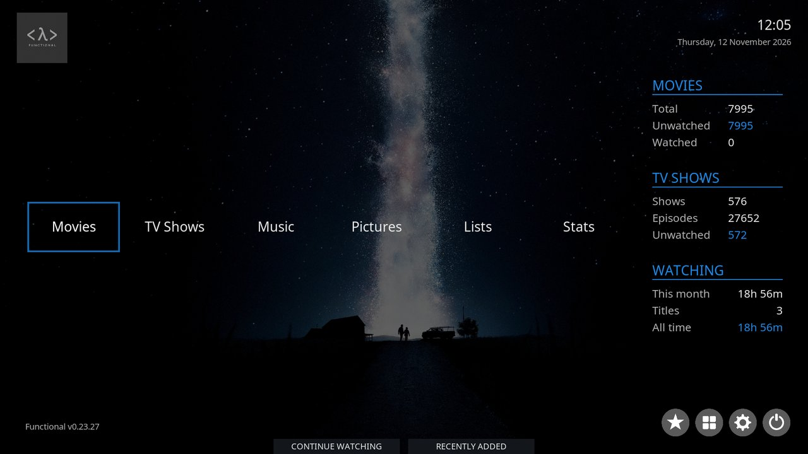
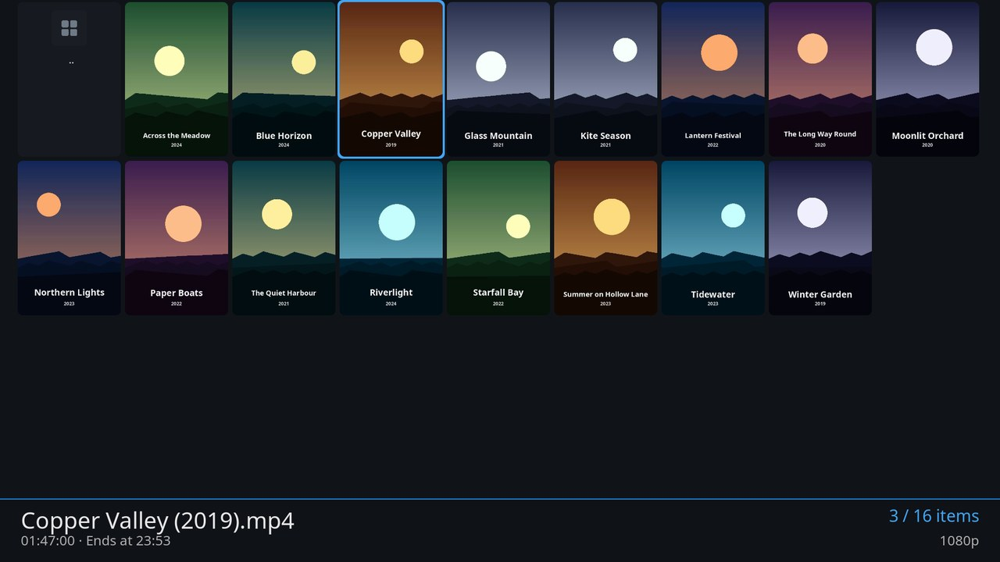
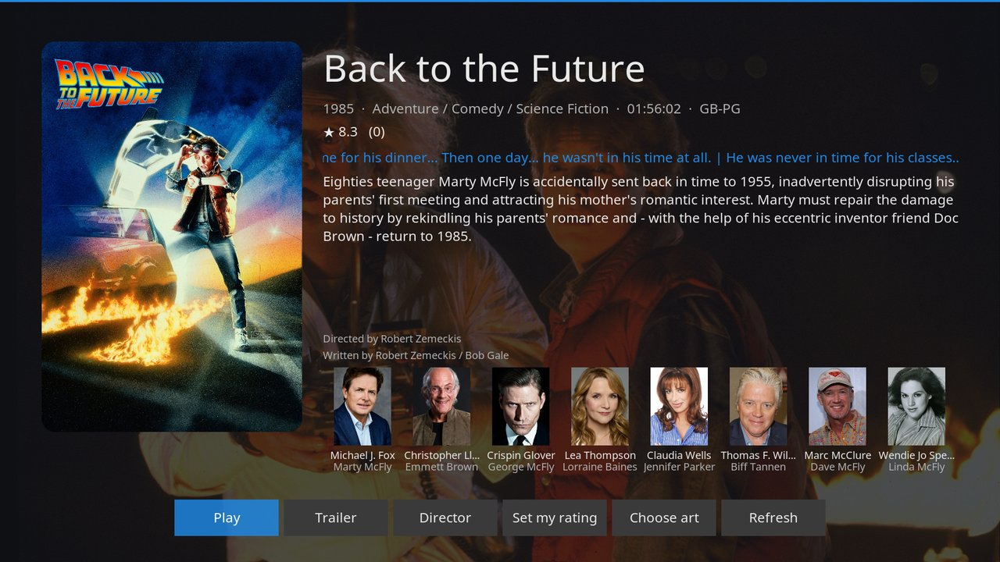
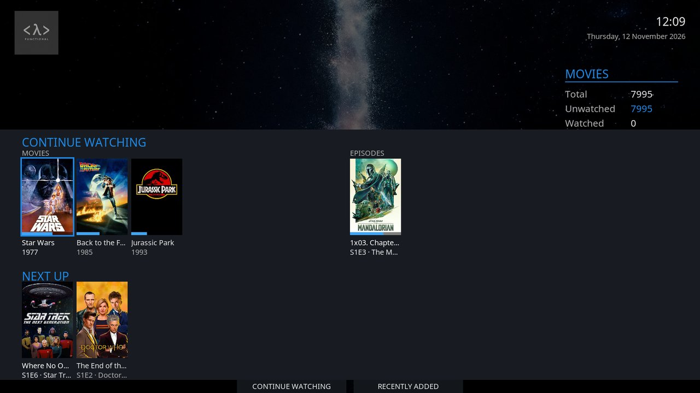
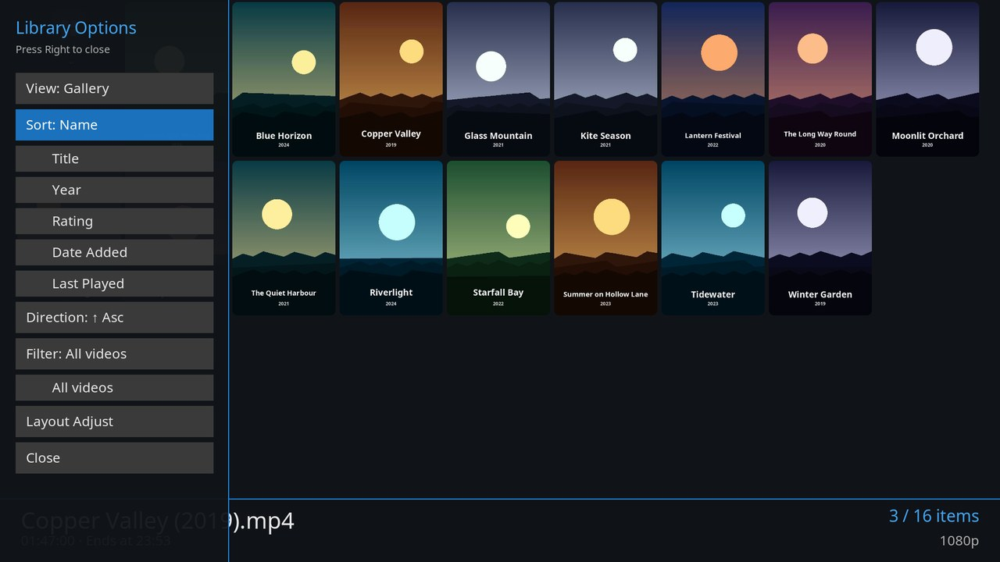
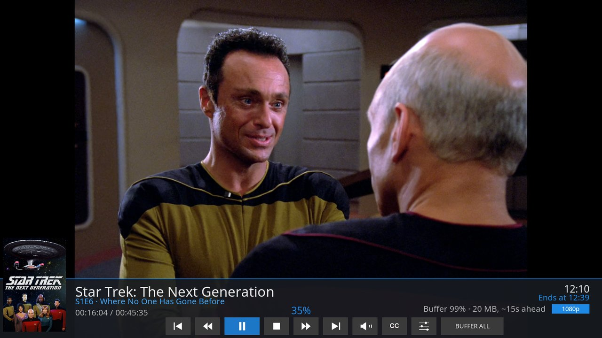
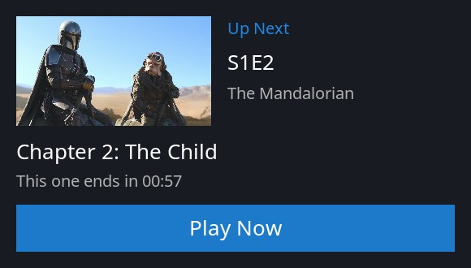
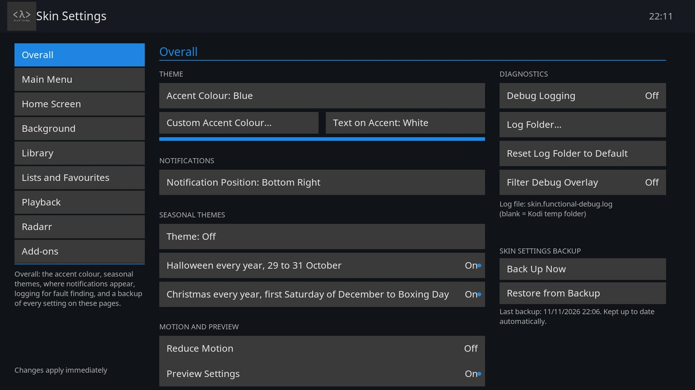

<a href="#quick-start">Quick start</a> · <a href="#highlights">Highlights</a> · <a href="INSTALL.md">Install guide</a> · <a href="docs/FEATURES.md">Every feature</a> · <a href="docs/SETTINGS.md">Settings</a> · <a href="CHANGELOG.md">Changelog</a>

  
  
  
  

**Your films and shows first, and every screen yours to set up.** Functional is a clean Kodi 21 skin built around your library: big poster art, backdrops from what you actually watch, Next Up behind a tab on Home, and a settings page for nearly everything you see, so you shape the layout instead of putting up with one.

| | |
| --- | --- |
|  |  |
| Poster gallery with resolution badges | Film information with cast |

## Quick start

Functional needs Kodi 21 (Omega). It installs once and then updates itself, like anything from the official Kodi repository.

1. Download the [repository zip](https://github.com/c0def0rc0ffee/Functional/tree/repo/zips/repository.functional) and install it from Kodi's **Install from zip file** (Kodi asks once to allow unknown sources).
2. **Install from repository > Functional Repository > Look and feel > Skin > Functional**.
3. Switch to it under **Settings > Interface > Skin**.

Other ways to install, including a release zip and an unattended update at boot, are in [INSTALL.md](INSTALL.md). Found a problem? [Open an issue](https://github.com/c0def0rc0ffee/Functional/issues). Like it? A star helps other people find it.

## Highlights

### Pick up where you left off

A tab on Home opens **Continue Watching**: films and episodes part way through, and a **Next Up** row with the next episode of every show you are following. Hold Select on any of them to resume, mark watched or unwatched, or, if you switch it on, hide it until it is played again.

### Backdrops from your own library

Home shows fanart from what you recently watched, a random pick from the whole library, one genre, a folder of your own pictures or a single image. Swap the whole set up on a time of day schedule, add a slow zoom, show it behind every screen, or keep a film playing behind the menus while you browse.

### Sort, filter and search without leaving the list

Press Left at the edge of any library view and **Library Options** slides out: view, sort and direction, watched filter, genre, search and layout, all applied as you go.

### An OSD that tells you when you will finish

Title, episode, elapsed and total time, the time the video ends, a resolution badge, and an optional buffer readout with a Full Buffer button for shaky connections.

### Next episode, one press away

Near the end of an episode a card offers the next one with **Play Now**. Off by default, and each show can have its own choice.

### Settings you can see

Nine pages of skin settings, a line under the page list on what the focused setting does, and an optional live preview of the screen it changes. Every setting is backed up as you go and can be restored in one step.

## And also

- **Lists**: named lists of anything playable, sent to the queue in order or shuffled
- **Favourites** sorted into Movies, TV, Music, Apps and Other, with counts
- **Sleep timer** at a set time, at the end of the current video, or after a number of episodes
- **Weather** window with hourly and five day forecasts, plus a widget beside the clock
- **Accent colours**: eight presets or any colour you pick, and Halloween and Christmas themes
- **Skip Intro pill** for intros and recaps your Jellyfin server has marked (needs the Intro Skipper or TheIntroDB server plugin; off by default)
- **Your own main menu**: eight slots, each any skin screen or any Favourite, at the top, centre or bottom

Every feature in detail: [docs/FEATURES.md](docs/FEATURES.md). Every setting, page by page: [docs/SETTINGS.md](docs/SETTINGS.md).

## Good to know

- Kodi 21 (Omega) only.
- PVR, Live TV and Games are not skinned; switch to Estuary for those.
- Film and TV artwork in the screenshots belongs to its owners and is shown only to illustrate the skin with a real library.

## Changes and licence

What changed in each release: [CHANGELOG.md](CHANGELOG.md).

Licensed under [GPL-2.0-or-later](LICENSE).
