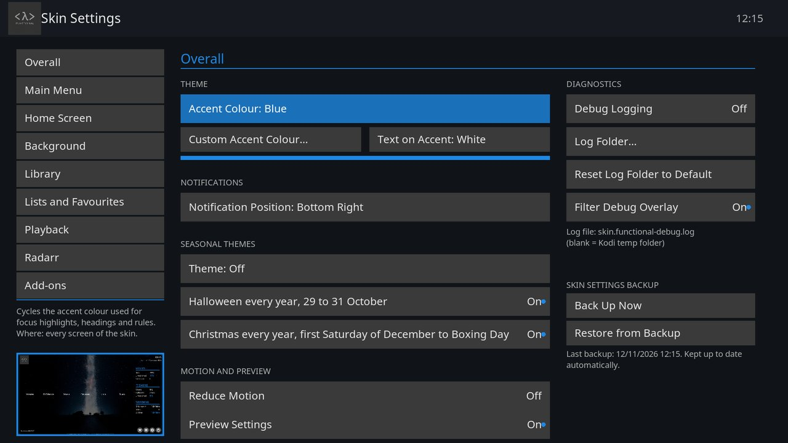

# Functional: skin settings

All settings live in **Settings > Skin Settings**. The pages are listed down the left; each page is described below. Back to the [README](../README.md), or see [FEATURES.md](FEATURES.md) for what each part of the skin does.

Toggle settings show an accent **dot** when on. Most changes apply immediately; a few service-backed ones take effect on the next launch.

## Overall

- **Accent colour**: Blue, Red, Green, Orange, Amber, Purple, Teal, Pink, or any colour from a picker, with the highlight shade following it
- **Text on Accent**: White, or Auto for dark text on a light accent such as Amber
- **Notification position**: 6 placements
- **Seasonal Themes**: Halloween and Devil's Night from 29 to 31 October, Christmas and Christmas Eve from the first Saturday of December to Boxing Day, each on by itself unless switched off, or picked by hand
- **Reduce Motion**: turns off the slide and fade effects across the skin; seasonal decorations keep their own switches
- **Preview Settings**: shows what the focused setting does, off by default
- **Diagnostics**: debug logging and its log folder
- **Skin Settings Backup**: Back Up Now and Restore from Backup, with the age of the snapshot shown

## Background

- The unified background mode, and the image or folder picker
- Dim
- Following the focused tile and a slow zoom, both off by default
- Slideshow interval and caption position
- The time of day schedule
- Whether the background (or live video) shows on every screen

## Main Menu

- Show or hide each menu item, including Weather, Lists and Stats
- The main menu position
- The corner bar position, its Favourites, Add-ons and Power buttons, and the Lists and Stats icons
- Invisible round buttons

## Home Screen

- The stats panels and Continue Watching
- Logo, date and time, weather widget, greeting beside the clock (off by default), footer and loading splash
- The sleep timer and its countdown

## Library

- Gallery thumbnail size, small-grid column count and poster shape
- Rounded corners for posters and thumbnails (off by default)
- Context menu position (centre or left edge)
- Default sort order and direction for Movies and TV Shows
- Info bar position and toggles for every metadata field
- 4K, HDR and resolution badges on the gallery posters (off by default)
- Title age on the info screens

## Lists and Favourites

- Where the Lists screen keeps its action buttons
- What porting a list does to the current queue
- An offer to power down when a Port by Time queue finishes (off by default)
- The default Favourites filter

## Playback

- **OSD position**
- **OSD thumbnail**
- **Video dim level**
- **Chapter marks**: a progress bar with chapter marks on the OSD and seek bar (off by default)
- **Sleep timer button** on the OSD (off by default)
- **Info panel**: an info panel that closes itself, and a film's logo on it (both off by default)
- **Start of film badge**: the picture mode, resolution and age rating (off by default)
- **Next episode card**: shown near the end of an episode, with Play Now (off by default; each show can choose its own from its info screen)
- **Skip Intro pill**: shown over intros and recaps your Jellyfin server has marked, with Skip Credits as a sub option (off by default). The markers come from the Intro Skipper or TheIntroDB plugin on the server. Each show can choose its own from its info screen
- **Playback Buffer**: buffer level on the OSD, the Full Buffer button, and a reset to Kodi defaults

## Radarr

Ties one list to a Radarr server, so that list gets a **Remove from Radarr** button on the Lists screen. It asks first, then Radarr removes every film on that list, deletes the files and blocks the films from being added again.

- **Address** and **API key**: where your Radarr server is. They are kept in the skin's add-on data folder, not in skin settings, and the key only ever shows as Set or Not set
- **List to remove from**: the one list that gets the button, or None
- **Dry run**: while on, nothing is removed and the log records what would have happened. Turning it off asks first
- **Test Connection** and **View Log**

## Add-ons

Settings for other add-ons on the same box. Each section shows only when its add-on is installed, and the page says so when neither is.

- **JellyStat**: JellyStat's figures under the stats, and **Let JellyStat manage the lists** (on by default)
- **Engage and Coming up**: the next Engage slot under the stats, the next few Engage slots down the left, and the Coming up list's switches for when queued slots really start, an Ends At line after each run, and scrolling through the week with Down
